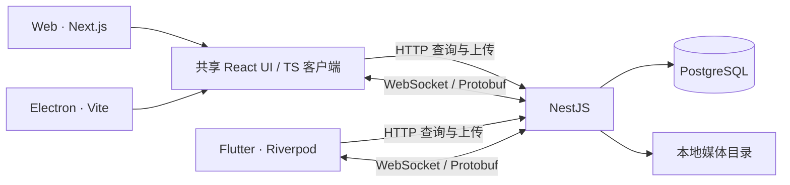

# 实现说明

## 数据与通信

Web 和 Electron 复用界面与通信包；Electron 使用 Vite 渲染器，不内嵌 Next 服务。Flutter 共用 `.proto` 和翻译源，独立实现 Dart 客户端。服务端为单体，第一版没有 Redis、消息队列或微服务。

HTTP 提供会话查询与创建、消息分页、媒体上传与读取。媒体读取支持 Range。WebSocket 使用 Nest WsAdapter / ws，直接传输 Protobuf 二进制，无 Socket.IO 帧协议。

## 消息一致性

1. 客户端生成 `clientMessageId`，显示发送中。媒体先通过 HTTP 上传，消息引用 `mediaId`。
2. 通过 `SEND_MESSAGE` 发送，每次请求另有 `requestId`。
3. 服务端验证内容与归属，事务内保存消息并更新会话时间。
4. 事务成功后广播 `MESSAGE_CREATED`，向发送请求返回包含最终消息的 `ACK`。
5. 客户端刷新 HTTP 缓存，按标识去重、移除待发状态。超时或断连后可手动重试。

ACK 表示已经持久化，不代表所有客户端均已收到。数据库 `(ownerId, clientMessageId)` 唯一约束保证并发重试只生成一条记录；相同标识携带不同内容会被拒绝。广播和 ACK 的到达顺序不作假设。

当前通知触发 HTTP 查询刷新，便于复用缓存和分页。个人 MVP 的开销可接受，后续可按需要把事件直接合并进缓存。

## 重连与历史

服务端 ping / pong 检测连接；客户端指数退避重连。收到 HELLO 后刷新会话和当前历史，弥补断连漏掉的事件。历史默认每页 40 条、最多 100 条，按 `(createdAt, id)` 排序，用消息 ID 作为游标。

Flutter 按 ID 合并消息，刷新最新页时替换历史游标，继续向前加载可以覆盖离线期间的空缺。React Query 无限查询重新获取已加载页面。第一版没有持久化事件日志或离线缓存，重启前尚未发送成功的待发记录仅保存在内存中。

## 协议与状态

Envelope 版本当前为 1，`requestId` 匹配 ACK / ERROR，`clientMessageId` 表示业务幂等。UUID 和时间分别用字符串与 ISO 字符串，大小和时长用 uint32，避免 JavaScript int64 精度问题。字段编号不得复用，删除字段需保留编号。修改契约后同时生成 TS / Dart。WS 帧上限 64 KiB，媒体本体走 HTTP。

| 数据 | React | Flutter | 保存位置 |
| --- | --- | --- | --- |
| 会话与历史 | React Query | Riverpod LearningController | PostgreSQL |
| 连接和待 ACK 请求 | RealtimeClient | LearningApi | 内存 |
| 草稿、预览、录音 | state / refs | Widget state / Controller | 内存 / 临时文件 |
| 语言和外观 | settings hook | SettingsController | localStorage / SharedPreferences |
| 图片和音频 | 媒体 URL | 媒体 URL | 服务端本地目录 |

只有会话和学习记录跨端同步，语言与外观是设备偏好，界面翻译不修改用户内容。

## 客户端与迁移

Electron 开启 contextIsolation / sandbox、关闭 nodeIntegration；preload 仅暴露平台标识与主进程校验后的 API 地址。麦克风请求限本应用。主进程按配置的 API origin 下发 CSP，生产脚本不允许内联脚本，开发模式为 Vite React Refresh 放开内联脚本。Windows 的可信本地文件路径通过标准 file URL 判断。

浏览器优先录 MP4，回退 WebM / Opus；Flutter 录 AAC / M4A。不同系统解码能力有差异，跨端录音需真机验证，必要时后续增加转码。服务器检查媒体签名，支持 JPEG、PNG、GIF、WebP、WebM、Ogg、WAV、M4A；没有视频消息。

云迁移时保留契约，替换 API 地址、接入真实身份上下文，将媒体目录替换为对象存储，启用 HTTPS / WSS。多实例时再加入跨实例广播。发布客户端需要各平台签名与流水线。当前客户端不会打包 Nest 服务或数据库。
